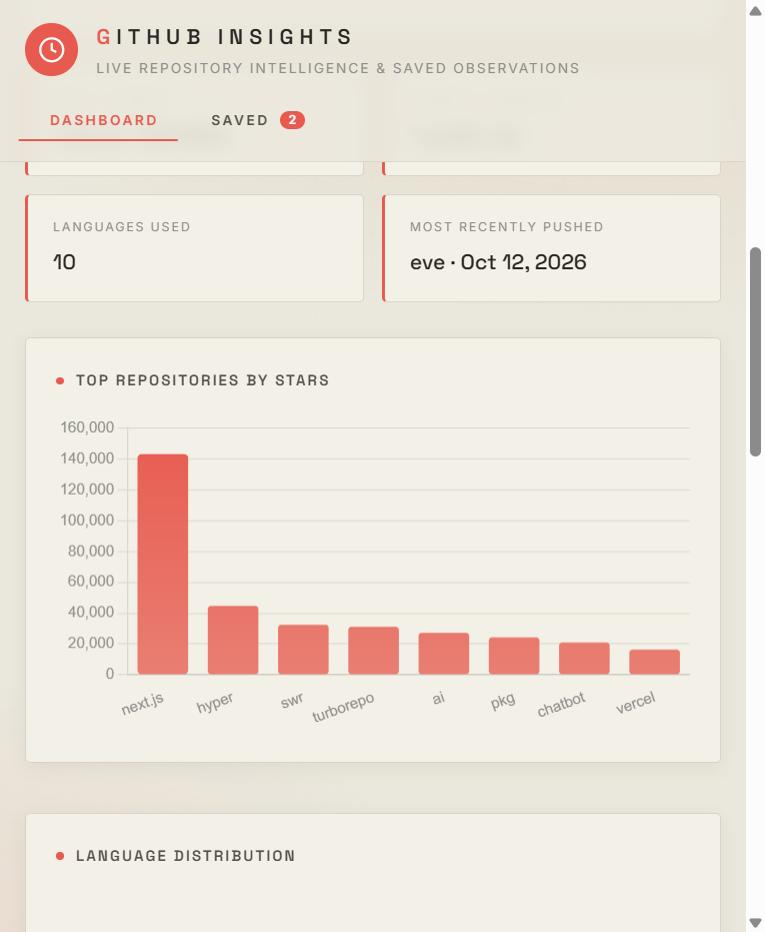
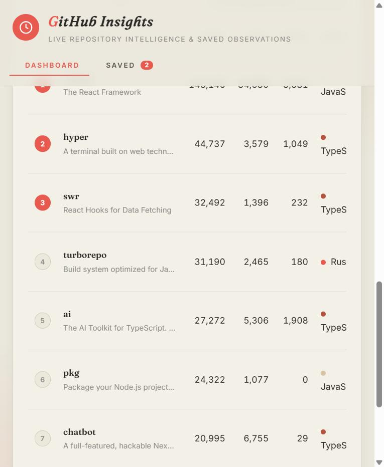
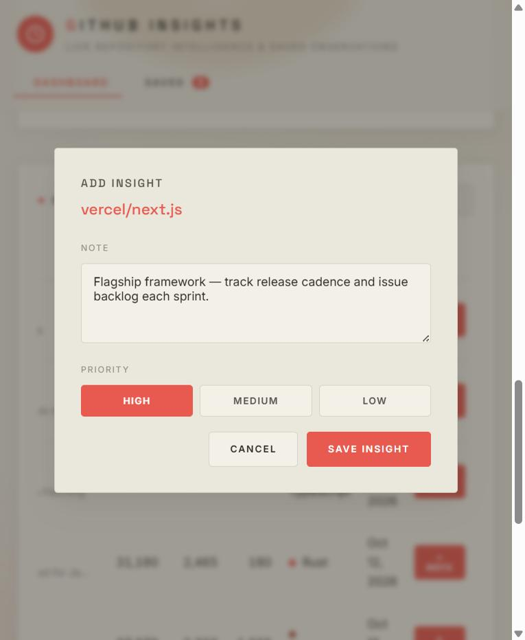
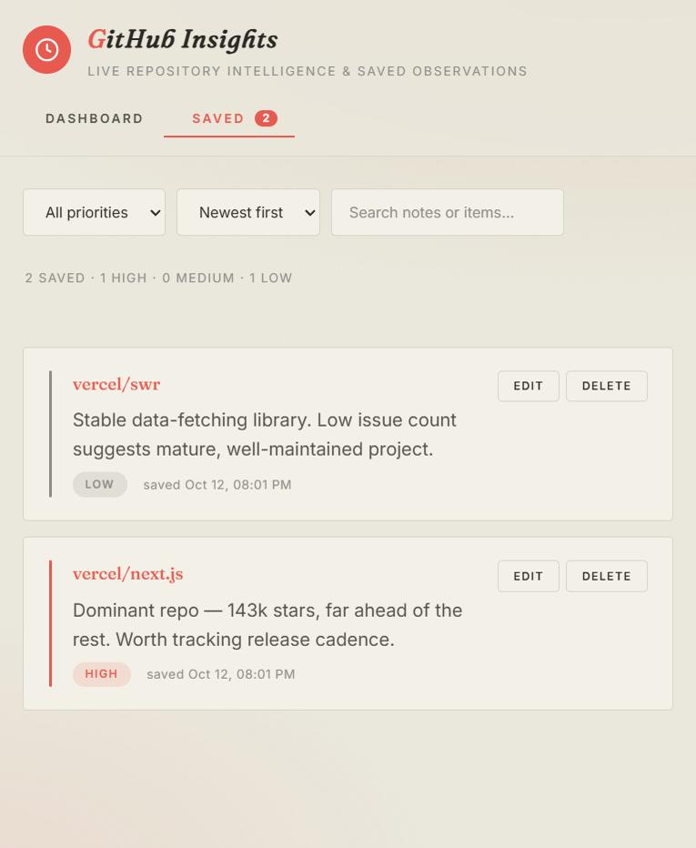
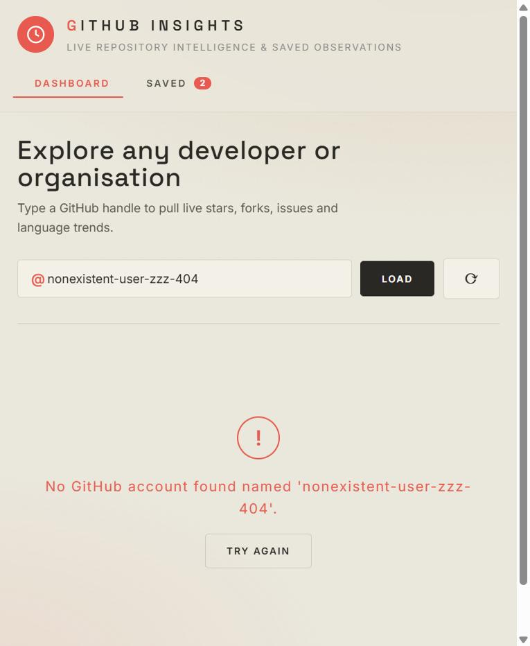

# GitHub Insights Dashboard — Explanation

## 1. What I built and the problem it solves

Raw API data is rarely useful on its own — a GitHub account's repository list is
dozens of JSON objects with no shape or story. I built an **API Insights
Dashboard** that fetches live data from the **GitHub REST API**, turns it into a
clean dashboard a non-technical person can read at a glance, and lets the user
**save observations** (a note plus a priority) against any repository to a SQL
database for later review.

In one line: **fetch live GitHub data → understand it as metrics and trends →
save and manage your own insights on top of it.**

## 2. What the system does — main features

- **Live data fetching** with three honest UI states: a loading spinner while
  fetching, a graceful error message on failure, and a manual **Refresh** button.
- **A real dashboard, not a data dump:** KPI tiles (repos, total stars, forks,
  open issues, average stars per repo), a derived-insight banner (most-starred
  repo, primary language, number of languages, most recently active repo), a
  **top-repos-by-stars** bar chart, a **language-distribution** doughnut chart,
  and a filterable repository table.
- **Save insights to SQL:** on any repository, write a note and pick a priority
  (High / Medium / Low); it is stored in SQLite.
- **Saved-insights view:** a dedicated tab showing item name, note content,
  priority (colour-coded), and timestamp.
- **Full CRUD:** Create and Read (required) plus Update and Delete (bonus).
- **Paginated repositories:** results are ranked and shown eight per page with a
  numbered pager, so the table stays readable instead of dumping every repo.
- **Refined editorial UI:** a warm, minimal design (cream canvas, coral accents,
  generous spaced type) with count-up KPIs, a sliding tab indicator, staggered
  reveals, and animated charts — built with CSS and anime.js.
- **Filter & search** saved insights by priority, free text, and sort order.
- **Graceful API failure handling:** unknown accounts, rate limits, timeouts and
  outages each produce a specific, friendly message — never a broken screen.

## 3. Tech stack, libraries, database, APIs, tools

| Area | Choice | Why |
|------|--------|-----|
| Backend | Python + **Flask** | Lightweight, quick to expose a clean JSON API |
| Database | **SQLite** (`sqlite3`) | Zero-config SQL, perfect for a single-file app |
| External API | **GitHub REST API** | Free, no key needed, rich structured data |
| HTTP client | **requests** | Robust server-side fetching with timeouts |
| Frontend | **Vanilla JS + Chart.js** | No build step; Chart.js for clean visuals |
| Animation | **anime.js + CSS** | Count-ups, staggered reveals, paginated rows |
| Type | **Fraunces (serif) + Inter** | Editorial serif display + readable body |
| Tests | **pytest** | 10 tests across DB, transform, and HTTP layers |

The GitHub call is **proxied server-side** rather than called from the browser.
That gives one place to shape the data and compute derived metrics, uniform
error handling, and the option to keep a `GITHUB_TOKEN` secret on the server.

## 4. How to run the project locally

```bash
pip install -r requirements.txt     # Flask, requests, pytest
python app.py                       # starts on http://127.0.0.1:5000
```

Open the URL, type a GitHub username or organisation (e.g. `vercel`, `facebook`,
`torvalds`) and press **Load**. Optionally raise the GitHub rate limit:

```bash
# PowerShell
$env:GITHUB_TOKEN = "ghp_your_token"; python app.py
```

Run the tests:

```bash
python -m pytest -q        # -> 10 passed
```

## 5. How it works — architecture

```
Browser (dashboard)  ──►  Flask  ──►  GitHub API        (live metrics)
         │                  │
         └──────────────────┴────►  SQLite (insights)   (saved observations)
```

- **`app.py`** — Flask routes. `/api/github/<account>` fetches repos, drops
  forks, aggregates totals, computes derived insights, and returns dashboard-
  ready JSON. `/api/insights` is a small CRUD API.
- **`db.py`** — a framework-free SQLite data-access layer. Every query is
  parameterised; ordering is whitelisted (never interpolated) to avoid injection.
- **`schema.sql`** — the `insights` table plus two indexes.
- **`static/`** — the single-page dashboard (`index.html`, `style.css`,
  `app.js`). Two tabs (Dashboard, Saved Insights) share one modal for create/edit.

## 6. Sample inputs, outputs, and screenshots

**Input:** the GitHub account `vercel`.
**Output:** 98 repositories aggregated into 517,187 total stars, 84,524 forks,
11,888 open issues, an average of 5,277 stars per repo, TypeScript as the primary
language across 10 languages, and `vercel/next.js` as the most-starred repo.

*The dashboard — count-up KPI tiles and derived insights on a warm, editorial canvas:*


*Charts — top repositories by stars and language distribution, in the brand palette:*



*Paginated repositories — ranked, eight per page with a numbered pager:*



*Saving an insight (note + priority) against a repository:*



*The saved-insights view — item, note, priority, timestamp, with Edit/Delete:*



*Graceful error state for an unknown account:*



## 7. Design decisions

- **Server-side API proxy + transform.** The browser never sees raw GitHub JSON;
  it receives exactly the metrics it renders. One place owns data shaping and
  error handling.
- **Derived metrics over raw fields.** Averages, rankings, and a language
  breakdown answer "what does this account look like?" rather than listing fields.
- **An extensible single-table schema.** A `source` column and generic
  `item_name` / `item_url` mean a second API (weather, movies, …) could reuse the
  same table without a migration — the schema supports future features by design.
- **Safety in the data layer.** Parameterised queries everywhere; `priority` is
  CHECK-constrained in SQL and validated in Python; `ORDER BY` is whitelisted.
- **Honest UI states.** Loading, error, and empty states are first-class, so the
  app never looks broken while the network is slow or a request fails.

## 8. Assumptions

- Public repositories are the subject; forks are excluded so metrics reflect the
  account's own work.
- The GitHub `pushed_at` timestamp represents "recent activity".
- Up to 100 repositories are fetched (one API page) — enough for the dashboard's
  metrics without pagination.
- Unauthenticated use is assumed (60 requests/hour); a `GITHUB_TOKEN` raises this.

## 9. Known limitations

- **No pagination** beyond the first 100 repos, so very large accounts are
  partially summarised.
- **Rate limits** can be hit without a token after a handful of refreshes.
- **Insights are not yet linked** to a live snapshot of the metric they describe
  (the note is free text), so an observation won't auto-update if stars change.
- **Single user / no auth** — the saved insights are shared, not per-account.

## 10. What I would improve next

1. Paginate and cache GitHub responses (and cache per account for a few minutes).
2. Store a metric snapshot alongside each insight, so "143k stars" is captured at
   save time and changes can be tracked.
3. Add a second data source (e.g. weather or movies) to prove the schema's
   `source` column — the UI and DB are already shaped for it.
4. User accounts so insights are private and per-user.
5. A small trend view (stars over time) using the GitHub stats endpoints.
