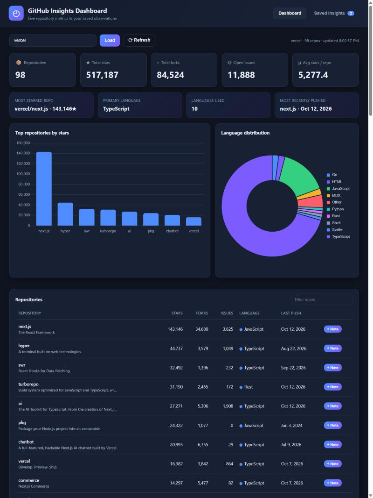

# GitHub Insights Dashboard

Pull **live data from the GitHub API**, turn it into a dashboard a non-technical
person can read at a glance, and **save observations** (note + priority) against
any repository to a SQL database.

Built for Assignment 2 — Web Development & Data Engineering.



## Why GitHub?

GitHub's API is free, needs no key for public data, and is rich enough to derive
real insight from — stars, forks, issues, languages, and push activity across an
account's repositories. That lets the dashboard show *metrics and comparisons*,
not just raw fields.

## Features

- **Live data** with proper **loading**, **error**, and **manual refresh** states.
- **Derived metrics**, not a raw dump: total/average stars, fork counts, open
  issues, most-starred repo, primary language, language distribution, and the
  most recently active repository.
- **Two charts** (top repos by stars; language distribution) plus a filterable
  repository table.
- **Save insights** — write a note and set a priority (High / Medium / Low) on
  any repo; stored in SQLite.
- **Saved view** showing item name, note, priority, and timestamp.
- **Full CRUD** — Create, Read, Update, Delete (Update/Delete were bonus).
- **Filter & search** saved insights by priority, text, and sort order.
- **Graceful failure** — unknown users, rate limits, and outages show a friendly
  message instead of a broken screen.

## Tech stack

| Layer     | Choice                          |
|-----------|---------------------------------|
| Backend   | Python + Flask                  |
| Database  | SQLite (via `sqlite3`)          |
| API       | GitHub REST API                 |
| Frontend  | Vanilla JS + Chart.js (CDN)     |
| HTTP      | `requests`                      |
| Tests     | pytest (10 tests)               |

## Run it locally

```bash
pip install -r requirements.txt
python app.py
# open http://127.0.0.1:5000
```

Optional: set a token to raise GitHub's rate limit from 60 to 5000 requests/hour:

```bash
# PowerShell
$env:GITHUB_TOKEN = "ghp_your_token"
python app.py
```

Run the tests:

```bash
python -m pytest -q        # -> 10 passed
```

## Deploy (Render — free)

This repo includes a `render.yaml` blueprint, a `Procfile`, and `runtime.txt`, so
it deploys as a free web service with no extra config:

1. Push to GitHub (already done).
2. On [render.com](https://render.com), sign in with GitHub → **New + → Blueprint**.
3. Pick this repository and click **Apply**. Render builds and gives you a public
   `https://…onrender.com` URL.

Notes: the free tier sleeps after ~15 min of inactivity (first request then takes
~30–60 s to wake), and its filesystem is ephemeral, so the SQLite insights reset
on redeploy. For persistence, attach a paid disk or point `INSIGHTS_DB` at a
managed database. Optionally set a `GITHUB_TOKEN` env var in the Render dashboard
to raise the API rate limit.

## API endpoints

| Method | Path                     | Purpose                          |
|--------|--------------------------|----------------------------------|
| GET    | `/api/github/<account>`  | Live metrics for a user/org      |
| GET    | `/api/insights`          | List saved insights (`?priority=`, `?q=`, `?order=`) |
| POST   | `/api/insights`          | Create an insight                |
| PUT    | `/api/insights/<id>`     | Update an insight                |
| DELETE | `/api/insights/<id>`     | Delete an insight                |

## Database schema

A single, extensible `insights` table (see [`schema.sql`](schema.sql)):

| Column | Type | Notes |
|--------|------|-------|
| id | INTEGER PK | autoincrement |
| source | TEXT | defaults to `github`; lets a future API reuse the table |
| item_name | TEXT | e.g. `facebook/react` |
| item_url | TEXT | link back to the item |
| note | TEXT | the observation |
| priority | TEXT | `High` / `Medium` / `Low` (CHECK-constrained) |
| created_at | TEXT | ISO-8601 UTC |
| updated_at | TEXT | set on edit |

See [`EXPLANATION.md`](EXPLANATION.md) for the full write-up.
